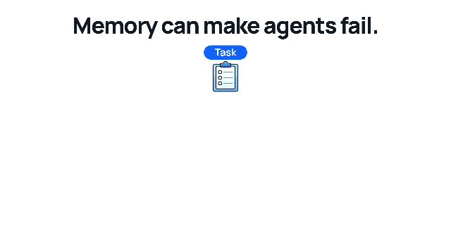
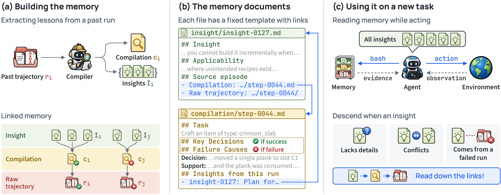

<h1 align="center">WikiTrace</h1>

<p align="center"><b>Don't Just Trust Your Memory: Evidence-Linked Memory Reduces Memory-Induced Degradation in LLM Agents</b></p>

<p align="center">
  Yukyeong Lee<sup>*</sup> · Yumin Choi<sup>*</sup> · Jinheon Baek<sup>†</sup> · Sung Ju Hwang<sup>†</sup><br>
  KAIST AI · DeepAuto.ai<br>
  <sub><sup>*</sup>Equal contribution · <sup>†</sup>Co-advisors</sub>
</p>

<p align="center">
  <a href="https://arxiv.org/abs/2611.14320"></a>
  <a href="https://yukyeongleee.github.io/wikitrace/"></a>
  
  
  <br>
  <a href="https://huggingface.co/papers/2611.14320"></a>
</p>

<p align="center"></p>
<p align="center"><b>Figure 1. Memory-induced degradation and WikiTrace</b></p>

> [!NOTE]
> **Memory can make an agent fail a task it solves without memory.** The problem is worse when runs are too costly to verify memory items. WikiTrace links every insight to the compilation and raw trajectory of the run it came from. The agent receives all insights up front and opens the source run with terminal tools when an insight lacks a detail, comes from a failed run, or disagrees with another. WikiTrace is the best method on all eight suites, +8.5 points over the best prior memory method on average, with the lowest Regression (4.5%).

## Method overview

<p align="center"></p>
<p align="center"><b>Figure 2. Overview of WikiTrace</b></p>

## Install

Requires Python 3.11+, [uv](https://docs.astral.sh/uv/), Node 20 and Docker.

```bash
uv sync --extra dev
cp .env.example .env              # set OPENROUTER_API_KEY
set -a; . ./.env; set +a

scripts/setup/pi.sh               # the Pi terminal agent at a pinned commit, with its patches
scripts/setup/sandbox_image.sh    # the --network none sandbox the agent runs in
```

<details>
<summary><b>Benchmarks</b></summary>

Each installer writes one benchmark under `$DATA_ROOT/<benchmark>` (default `data/`). If you change `DATA_ROOT`, set the benchmark's `dataset:` root in its config to the same path.

```bash
DATA_ROOT=/path/to/data scripts/setup/alfworld.sh
DATA_ROOT=/path/to/data scripts/setup/scienceworld.sh
DATA_ROOT=/path/to/data scripts/setup/plancraft.sh
DATA_ROOT=/path/to/data scripts/setup/tau3.sh
DATA_ROOT=/path/to/data scripts/setup/appworld.sh && scripts/setup/appworld_env_image.sh
```

</details>

## Quick start

`wikitrace` works in three steps.

| Step | Command | What it does |
|---|---|---|
| 1 | **`build`** | runs the agent without memory on a suite's training tasks and compiles each run into a compilation and insights: the memory (corpus) of one trial |
| 2 | **`run`** | tests one method on the suite's test tasks with the memory of the same trial |
| 3 | **`analyze`** | compares each method with No Memory: Gain, Regression and plots |

A trial is one replicate: `build --trial N` and `run --trial N` go together. `configs/base.yaml` holds the paper's settings, and each benchmark has its own config.

### 1. Build the memory

`build` runs the agent without memory on the training tasks of a suite. The compiler then reads each finished run and writes a compilation of it and up to three insights, each linked to that run. The result is the memory of one trial, stored under `outputs/corpus/`.

```bash
# template
uv run wikitrace build \
    --config     configs/<benchmark>.yaml \
    --benchmark  <benchmark> \
    --suite      <suite> \
    --trial      <N>

# example
uv run wikitrace build \
    --config     configs/alfworld.yaml \
    --benchmark  alfworld \
    --suite      valid-seen \
    --trial      0
```

### 2. Test a method

`run` evaluates one method on the test tasks of the same suite and trial. `--method` selects what the agent receives from the memory.

```bash
# template
uv run wikitrace run \
    --config     configs/<benchmark>.yaml \
    --benchmark  <benchmark> \
    --suite      <suite> \
    --trial      <N> \
    --method     <method>

# example
uv run wikitrace run \
    --config     configs/alfworld.yaml \
    --benchmark  alfworld \
    --suite      valid-seen \
    --trial      0 \
    --method     wikitrace
```

| `--method` | Method | Memory given to the agent |
|---|---|---|
| `no-memory` | No Memory | none |
| `kinj` | Knowledge Injection | every insight and the three most similar training runs, in the task message |
| `wikitrace` | WikiTrace | the same message, plus the memory mounted read-only and a prompt to check insights in their source runs |

`--corpus PATH` makes `kinj` and `wikitrace` read another built memory, for example one from a different trial.

### 3. Compare with No Memory

`analyze` collects the per-sample results of every finished run under `outputs/` and measures each method against No Memory. Gain is the share of tasks No Memory fails that the method solves, and Regression is the share of tasks No Memory solves that the method fails. It writes both with 95% intervals, as tables and plots.

```bash
uv sync --extra analysis
uv run wikitrace analyze all \
    --runs  outputs/ \
    --out   analysis/
```

Another memory method can be evaluated by adding its per-sample rows under its own `method` label. See [src/wikitrace/analysis/README.md](https://github.com/yukyeongleee/wikitrace/blob/main/src/wikitrace/analysis/README.md) for the definitions, the input format and the separate `export`, `stats` and `plot` steps.

### Notes

- A memory built under a different config, prompt or commit is refused, so a run never reads stale memory by accident.
- Running the same command again resumes a killed run and skips the samples it already scored.

<details>
<summary><b>Benchmarks and suites</b></summary>

| Benchmark | `--benchmark` | `--config` | `--suite` |
|---|---|---|---|
| ALFWorld | `alfworld` | `configs/alfworld.yaml` | `valid-seen`, `valid-unseen` |
| ScienceWorld | `scienceworld` | `configs/scienceworld.yaml` | `scienceworld` |
| PlanCraft | `plancraft` | `configs/plancraft.yaml` | `plancraft-seen`, `plancraft-unseen` |
| τ³-bench Retail | `tau3` | `configs/tau3.yaml` | `retail` |
| AppWorld | `appworld` | `configs/appworld.yaml` | `test-normal`, `test-challenge` |

Suites of one benchmark share the training tasks, so they share one memory per trial.

</details>

## Outputs

```
outputs/corpus/<benchmark>/<train_group>/rep-<NN>/   the memory built for one trial
outputs/<benchmark>/<suite>/<method>/trial-<NN>/
  run.json                 method, trial, models, fingerprint, status
  metrics/samples.jsonl    one row per test sample
  metrics/summary.json     suite score and API cost
  test/trajectories/       each episode's turns and rendered prompts
```

[src/wikitrace/memory/README.md](https://github.com/yukyeongleee/wikitrace/blob/main/src/wikitrace/memory/README.md) describes the memory layers and what the agent sees. [src/wikitrace/harness/README.md](https://github.com/yukyeongleee/wikitrace/blob/main/src/wikitrace/harness/README.md) describes the agent, the sandbox and the benchmark environments.

## Citation

```bibtex
@misc{lee2026wikitrace,
  title  = {Don't Just Trust Your Memory: Evidence-Linked Memory Reduces Memory-Induced Degradation in LLM Agents},
  author = {Lee, Yukyeong and Choi, Yumin and Baek, Jinheon and Hwang, Sung Ju},
  year   = {2026},
  eprint = {2611.14320},
  archivePrefix = {arXiv},
  primaryClass  = {cs.AI},
  url    = {https://arxiv.org/abs/2611.14320}
}
```

## License

Apache-2.0.
